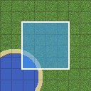

# 16tosave



A client-side Fabric mod for Minecraft Java **26.3**. While you play on a server, it saves the
chunks your client receives. Later you open a map of everything saved, pick the chunks you
want, and export them into a normal singleplayer world.

The mod only stores what the server already sends to you as a normal player. It sends no
packets, requests no chunks and does nothing a server can see. Some servers forbid world
downloading in their rules; following them is up to you.

## Features

- **Capture:** blocks, biomes, block entities and entities of every chunk your client receives,
  saved as ordinary Anvil region files. Chest, barrel, furnace… contents are saved once you
  open the container (the server never sends them otherwise).
- **Map:** top-down view of the cache with four levels of detail, biome colours and relief
  shading, a height slider to look under the Nether roof, live updates while you play, and
  orange stripes on chunks with containers you never opened.
- **Selection:** drag rectangles, click chunks or whole regions, select a radius around you or
  the world spawn, select all, invert, undo. Selections are saved per server and dimension, and
  you can keep named ones.
- **Export:** a new world in `saves/`, ready to open from the world list: the selected chunks
  of each dimension, void around them, a world icon drawn from the map, and a report of what
  was skipped.

## Install

1. Install [Fabric Loader](https://fabricmc.net/use/) (0.19.3 or newer) for Minecraft 26.3.
2. Download `16tosave-<version>.jar` from the
   [releases](https://github.com/tapinko/16tosave/releases) and put it, together with
   [Fabric API](https://modrinth.com/mod/fabric-api) for 26.3, into `.minecraft/mods/` (or your
   launcher instance's `mods` folder).

The mod is client-only: nothing is installed on the server.

## Use

1. **Play.** Join a server and play as usual. Chunks are saved when they unload, and loaded
   chunks that changed are saved again every 30 seconds.
2. **Open the map:** pause menu → **16tosave** (top right), or bind the "Open 16tosave map" key
   (Options → Controls → Key Binds → 16tosave). Right-drag to pan, wheel to zoom, slider on the
   right to cut off everything above a height, dimension button to switch dimension.
3. **Select chunks:** left-drag a rectangle (Shift adds, Ctrl removes), click single chunks, or
   use the second toolbar row (Select all, Invert, Clear, Undo / Ctrl+Z, Radius, Around me,
   Around spawn). The status line shows how many chunks are selected and roughly how big the
   export will be. **Save as…** / **Load…** keep named selections.
4. **Export…** (map toolbar): choose the world name, the dimensions, what an exported Nether or
   End looks like outside the selection (nothing, or vanilla terrain), game mode, commands and
   entities. The export runs in the background; **Hide** keeps it running, **Cancel** removes
   everything it wrote, and a toast reports the result.
5. **Settings** (map toolbar): turn capture on/off globally, per server or per dimension, see
   what was written, clear the cache of the current server.

Where things are:

- cache: `.minecraft/16tosave/<server>/<namespace>/<dimension>/region/r.X.Z.mca` (and
  `entities/`); MCA Selector and similar tools can open these files;
- selections: next to the cache, `selection.json` and `selections/<name>.json` ("Clear cache"
  keeps them);
- export report: `saves/<world>/16tosave-export.json` (skipped chunks, chunks with containers
  you never opened).

## Settings

`.minecraft/config/16tosave.json`, plain JSON, safe to edit while the game is closed:

| Key | Default | Meaning |
|---|---|---|
| `capture.enabled` | `true` | master switch |
| `capture.entities` | `true` | save entities |
| `capture.observeContainers` | `true` | save contents of containers you open |
| `capture.dimensions` | `{"*": true}` | per-dimension switch, `"*"` = default |
| `capture.liveIntervalSeconds` | `30` | how often changed, still-loaded chunks are saved again |
| `capture.tickBudgetMicros` | `1500` | max. time per tick the mod may spend on the game thread |
| `capture.queueMiB` | `64` | memory for chunks waiting to be written |
| `capture.entityReplaceRange` | `24` | within this distance a chunk's entity list is replaced, farther away merged |
| `servers.<id>.capture` | `true` | per-server switch |
| `cache.maxSizeMiB` | `4096` | per-server cache size cap; least recently seen regions are deleted above it (never those with selected chunks) |
| `map.tileWorkers` | `2` | background threads that draw the map |
| `map.vramMiB` | `192` | GPU memory for map tiles |

## Known limitations

The full list, with workarounds, is in [`docs/LIMITATIONS.md`](docs/LIMITATIONS.md). The ones
you are most likely to meet:

- **Proxy networks** (BungeeCord/Velocity: several worlds behind one address) are written into
  one cache and get mixed. Until this is fixed, capture only one backend (Settings → "On this
  server") or clear the cache before you capture the one you want.
- Containers you never opened, chest minecarts/boats and donkey/llama inventories export empty.
- Only the overworld, the Nether and the End can be exported; the exported world has no
  structure data (no fortress or witch-hut spawns, no `/locate`).
- A void Nether/End makes Minecraft show its "experimental settings" warning when the world is
  opened. That is vanilla's rule for any non-vanilla Nether/End; the world works.
- On anti-xray servers the fake ores the server sends are what gets saved.

Bug reports and ideas: [issues](https://github.com/tapinko/16tosave/issues).

## Building from source

Needs **JDK 25**.

```sh
./gradlew build          # Windows: gradlew.bat build
./gradlew runClient      # development client with the mod loaded
```

The jar is in `build/libs/`. `./gradlew build` also runs the unit tests.

```
core/       pure Java (no Minecraft), unit-tested: coordinates, selection, map tiles, export files…
src/main/   the mod: capture/, storage/, map/, selection/, export/, config/, ui/
docs/       DESIGN.md, LIMITATIONS.md, TESTING.md, vanilla-api.txt (every Minecraft API the code uses)
```

New versions: set `mod_version` in `gradle.properties`, add a section to `CHANGELOG.md`, then
push a tag `v<version>`; GitHub Actions builds the jar and creates the release.

## How it was made

16tosave was written with [Claude Code](https://claude.com/claude-code), Anthropic's AI coding
tool, from a specification and with testing, feedback and decisions by the author. The design
and every Minecraft API it relies on are documented in [`docs/DESIGN.md`](docs/DESIGN.md) and
[`docs/vanilla-api.txt`](docs/vanilla-api.txt).

## License

[EUPL-1.2](LICENSE)
